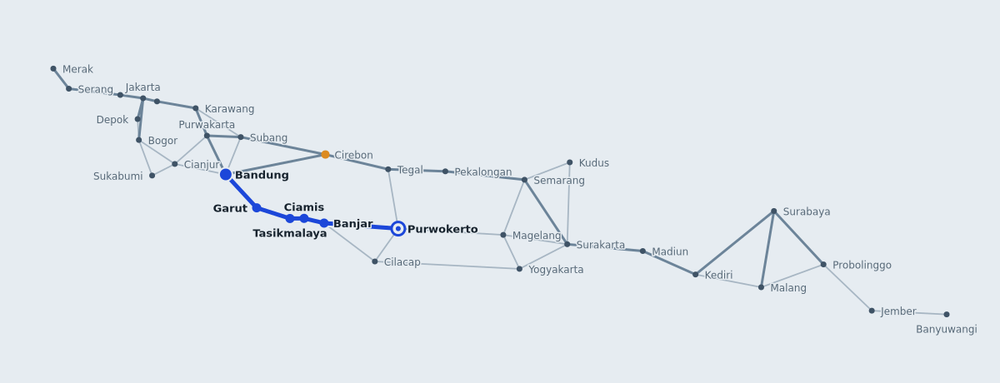

# Route Finder

[](https://github.com/compiledbeing/route-finder/actions)

A GPS-style route finder written in Rust. It loads a road network from JSON, finds routes with **BFS**, **Dijkstra** and **A\***, and can serve an interactive map where you click two cities and watch each algorithm search.



## Features

- Three algorithms behind one function: BFS (fewest stops), Dijkstra, and A\* with a haversine heuristic
- Two optimisation goals: shortest distance or fastest time (speed limits per road)
- Data-driven: the road network is a JSON file, so you can swap in your own map
- Readable CLI output, optional JSON export, and a side-by-side `--algo all` comparison
- `route-finder serve` starts a small [axum](https://github.com/tokio-rs/axum) server with a JSON API and an interactive canvas map
- The demo dataset and the web UI are compiled into the binary, so it runs from anywhere
- Typed errors, 33 tests (unit, integration, in-process API tests, doctest), clippy-clean, GitHub Actions CI

## Quick start

You need a recent stable [Rust toolchain](https://rustup.rs). It is developed and tested on Rust 1.91. The first build downloads the dependencies from crates.io.

```bash
cargo test
cargo run --release -- route --from Jakarta --to Surabaya
cargo run --release -- serve        # then open http://127.0.0.1:8080
```

To install the binary: `cargo install --path .`, then run `route-finder --help`.

## Command line

```
route-finder route --from <place> --to <place> [--algo bfs|dijkstra|astar|all]
                   [--metric distance|time] [--json out.json]
route-finder list
route-finder serve [--port 8080]

Global option:  --data <file.json>   use your own road network
```

Comparing the algorithms on one trip:

```
$ route-finder route --from Bandung --to Purwokerto --algo all
Algorithm     Distance        Time   Stops  Expanded  Time (us)
BFS           280.8 km  4 h 04 min       4        16        3.6
Dijkstra      234.9 km  4 h 42 min       6        19        4.3
A*            234.9 km  4 h 42 min       6         7        1.9

Bandung -> Purwokerto   [A*, shortest distance]
------------------------------------------------------------
  o Bandung
  |     56.4 km  1 h 08 min   Bandung-Garut Road
  o Garut
  |     43.4 km     52 min   Garut-Tasikmalaya Road
  o Tasikmalaya
  |     17.5 km     21 min   Southern Java Road
  o Ciamis
  |     25.4 km     31 min   Southern Java Road
  o Banjar
  |     92.1 km  1 h 51 min   Banjar-Wangon Road
  o Purwokerto
------------------------------------------------------------
Total    234.9 km  |  4 h 42 min  |  6 stops
Search   7 nodes expanded in 1.9 us
```

What the table shows:

- **BFS** found the route with the fewest stops, but not the shortest one (280.8 km vs 234.9 km).
- **Dijkstra** and **A\*** return the same optimal route.
- **A\*** reached it after expanding 7 cities instead of 19, because the heuristic steers it toward the destination.

## Web UI and API

`route-finder serve` serves the map and two endpoints on `127.0.0.1`:

| Endpoint | Description |
| --- | --- |
| `GET /api/graph` | All cities and roads |
| `GET /api/route?from=bandung&to=purwokerto&algo=astar&metric=distance` | Route, legs, totals and the order in which cities were searched |

Errors come back as `{"error": "..."}` with a 400 or 404 status.

In the UI, click a city to set the start, another to set the destination, and use the controls to switch algorithm or goal. The searched cities light up in the order the algorithm visited them, then the route is drawn. The table below the map compares all three algorithms for the same trip. The animation respects `prefers-reduced-motion`, and the colours follow your light/dark setting.

## Use it as a library

```rust
use route_finder::{find_route, parse_graph, Algorithm, Metric, DEFAULT_DATASET};

let graph = parse_graph(DEFAULT_DATASET)?;
let from = graph.find("Bandung").unwrap();
let to = graph.find("Purwokerto").unwrap();

let result = find_route(&graph, from, to, Algorithm::AStar, Metric::Distance)?;
if let Some(route) = result.route {
    println!("{:.1} km, {} stops", route.distance_km, route.path.len());
}
println!("searched {} cities", result.stats.nodes_expanded());
```

Build with `--no-default-features` to drop the HTTP server (and axum/tokio) and keep only the routing engine.

## Data format

```json
{
  "name": "Java Island Road Network",
  "default_speed_kmh": 50,
  "road_factor": 1.2,
  "nodes": [
    { "id": "bandung", "name": "Bandung", "lat": -6.9175, "lon": 107.6191 }
  ],
  "roads": [
    { "from": "bandung", "to": "garut", "road": "Bandung-Garut Road", "speed_kmh": 50 },
    { "from": "bogor", "to": "cianjur", "road": "Puncak Pass Road", "speed_kmh": 40, "distance_km": 62 }
  ]
}
```

- If `distance_km` is omitted, it is estimated as straight-line distance x `road_factor`.
- Roads are two-way unless `"one_way": true`.
- The loader rejects unknown cities, duplicate ids and roads shorter than the straight line (see below).

> The bundled dataset uses approximate coordinates and estimated road lengths. It is a demo, not a navigation source.

## How it works

| Algorithm | Minimises | Complexity | Notes |
| --- | --- | --- | --- |
| BFS | Number of stops | O(V + E) | Ignores road length and speed |
| Dijkstra | Distance or time | O((V + E) log V) | Optimal for non-negative weights |
| A\* | Distance or time | O((V + E) log V) worst case | Same answer as Dijkstra, usually far fewer expansions |

Design decisions worth knowing about:

- **One implementation for Dijkstra and A\*.** Dijkstra is A\* with a heuristic of zero, so the two cannot drift apart (`best_first` in `src/pathfinder.rs`).
- **The heuristic is admissible by construction.** For distance it is the haversine (straight-line) distance. For time it is that distance divided by the fastest speed on the map. `Graph::add_road` rejects any road shorter than the straight line, so the estimate can never exceed the true cost and A\* stays optimal.
- **"No route" is a value, not an error.** `RouteResult::route` is an `Option<Route>`, so a result can never claim to have found a path while holding an empty one. Only invalid input (an id outside the graph) returns `Err`.
- **Priority queue with lazy deletion.** `BinaryHeap` is a max-heap and `f64` is not `Ord`, so a small `QueueItem` wrapper orders by `f64::total_cmp`, reversed, with ties broken by node id so searches are deterministic. Instead of decreasing keys, stale entries are skipped when popped.
- **Typed errors in the library, `anyhow` in the binary.** `GraphError`, `LoadError` and `RouteError` are `thiserror` enums callers can match on; the CLI adds context such as which file failed to load.
- **Feature-gated server.** The `server` feature (on by default) pulls in axum and tokio. The router is exposed as a function, so the API tests call it in-process without opening a port.
- **Tests check properties, not just examples.** For every pair of cities and both metrics, Dijkstra and A\* must agree on the cost, BFS must never use more stops, and A\* must do less total work.

## Project layout

```
src/
  graph.rs       nodes, roads, adjacency list, haversine, validation
  pathfinder.rs  BFS, Dijkstra, A*, result types
  loader.rs      JSON dataset -> Graph
  export.rs      JSON shapes shared by the CLI and the API
  report.rs      plain-text output for the CLI
  server.rs      axum router and server (feature "server")
  main.rs        clap CLI
data/            java_island.json
web/             index.html (canvas map, no build step)
tests/           pathfinder.rs (algorithms), api.rs (HTTP)
```

## Ideas for extending it

- Import a real road network from OpenStreetMap
- Bidirectional search, or landmark (ALT) heuristics for large graphs
- Draw road geometry instead of straight segments
- Time-of-day traffic weights, turn penalties, avoid-toll option
- Alternative routes (k-shortest paths)

## License

MIT, see [LICENSE](LICENSE).
